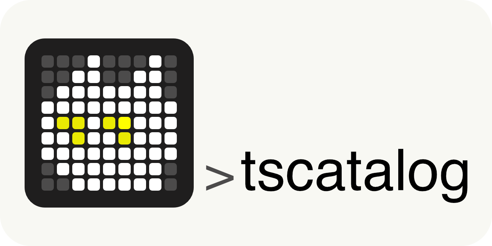

<picture>
  <source media="(prefers-color-scheme: dark)" srcset="docs/tscatalog-banner.dark.png">
  
</picture>

# tscatalog

[](LICENSE)
[](https://github.com/nilox94/tscatalog/releases/latest)
[](https://github.com/nilox94/tscatalog/actions/workflows/test.yml)
[](go.mod)

One catalog file starts local processes. Published rows are at `https://<label>.<tailnet>.ts.net` on port 443.


That recording is `list`, `describe`, `ps`, and `health`. The services are unpublished, so the names stay `https://<label>.<tailnet>.ts.net` and public health is `skip`. `plan` and `up` are not shown.

A published row is four pieces:

| Piece | What it is |
| --- | --- |
| Local process | A command or a Compose stack. `local` stays on loopback. |
| VIP Service | The Tailscale name for that process, `svc:<label>`. |
| Serve | The proxy on this machine from the HTTPS name to `local`. |
| ACL grant | The tailnet rule that lets `access.src` open the name. |

The label is the `vip` field. When `vip` is empty, the label is the service name, with dots replaced by hyphens. The tailnet name is not stored in the catalog. The machine that hosts the name has to be tagged. A device logged in only as a user cannot host a VIP Service. [Host tag](docs/tailnet.md#host-tag).

## Requirements

- Linux or macOS. Release binaries are amd64 and arm64.
- `tailscale` on `PATH`, and `tailscale status` works.
- HTTPS certificates enabled on the tailnet.
- Go 1.26, or a binary from the release.
- `TS_API_KEY` or an OAuth client before `plan`, `apply`, or `up`.

## Install

### Homebrew

```
brew tap nilox94/tscatalog
brew install --cask tscatalog
```

That installs `tscatalog` and `cat9s`. The cask is updated from each release in [nilox94/homebrew-tscatalog](https://github.com/nilox94/homebrew-tscatalog).

### Go

```
go install github.com/nilox94/tscatalog/cmd/...@latest
```

That installs `tscatalog` and `cat9s` into `$(go env GOPATH)/bin`. From a checkout, `go install ./cmd/...` does the same.

Binaries, checksums, and the macOS quarantine step: [docs/install.md](docs/install.md).

## Auth

An API access token or an OAuth client. Put it in the environment, or in a gitignored `.env` next to the catalog. See [`.env.example`](.env.example). Process environment wins. Only `TS_*` keys are loaded from that file.

| Variable | |
| --- | --- |
| `TS_API_KEY` | An [API access token](https://tailscale.com/docs/reference/key-secret-management) (`tskey-api-…`). Same token as [Tailscale API authentication](https://tailscale.com/docs/reference/tailscale-api#authentication). Not a device auth key. |
| `TS_OAUTH_CLIENT_ID` and `TS_OAUTH_CLIENT_SECRET` | An [OAuth client](https://tailscale.com/docs/features/oauth-clients). Scope `all`. Tailscale has no narrower scope for VIP Services. |
| `TS_TAILNET` | Optional. Default `-`, the credential's tailnet. |

`list`, `describe`, `health`, `ps`, `logs`, `stop`, `autostart`, and `up --local` do not require a credential. What they print without one: [Without a credential](docs/tailnet.md#without-a-credential).

## First run

From a clone of this repo:

```
mkdir -p ~/.config/tscatalog
cp catalog.example.yaml ~/.config/tscatalog/catalog.yaml
cp .env.example ~/.config/tscatalog/.env
```

Edit `~/.config/tscatalog/.env` before `plan`. The command reads `.env` from the directory of the catalog it resolved. Once `~/.config/tscatalog/catalog.yaml` exists, a `.env` in the clone is not that file. Which file is chosen: [Discovery](docs/catalog.md#discovery).

```
tscatalog plan
tscatalog up
```

`plan` diffs VIP Services, local Serve, and the ACL. It does not start processes and it does not write. `up` starts local processes before it checks the credential. If the credential is missing, those processes are already up and the tailnet write fails. Run `plan` first. `up --local` starts and probes without writing the tailnet.

`plan` output for a new service is in [docs/tailnet.md](docs/tailnet.md#plan).

## Catalog

A service is a command or a Compose stack. One file can include both. A command is an argv (`start`, `stop`), not a shell string. A Compose stack is `kind: compose` plus the project directory.

The commands and directories below are placeholders. Replace them before `up`.

```yaml
endpoint: tcp:443
access:
  src: [autogroup:member]
  autoApproveHost: tag:server
  tagOwners: [autogroup:admin]
services:
  - name: web
    local: http://127.0.0.1:8080
    launch:
      start: [my-web, start]
      stop: [my-web, stop]
    check:
      path: /health

  - name: edge
    local: http://127.0.0.1:8083
    launch:
      kind: compose
      cwd: ~/src/edge
      files: [compose.yaml]
      services: [proxy]
```

Fields, Compose, `requires`, and autostart: [docs/catalog.md](docs/catalog.md). The file to copy is [`catalog.example.yaml`](catalog.example.yaml).

## Commands

| Command | Credential | What |
| --- | --- | --- |
| `plan` | yes | Diff VIP Services, local Serve, and the ACL. No processes and no writes. [Plan](docs/tailnet.md#plan). |
| `apply` | yes | Write that diff. [Apply](docs/tailnet.md#apply). |
| `up` | yes, unless `--local` | Start, then apply, then [health](docs/health.md). `--local` skips the tailnet. |
| `restart` | to republish | Stop, then start, then republish those names. No ACL write. [Restart](docs/tailnet.md#restart). |
| `health` | no | Probe bind, local HTTP, public HTTPS, and host approval. |
| `list` | no | Names, API ports, Serve targets, and the public URL. |
| `describe` | no | Every service, or one service and its launch rows. |
| `ps` | no | Processes and containers. |
| `logs` | no | `logs <service>` or `logs <service> <name>`. [Logs](docs/catalog.md#logs). |
| `stop` | no | Stop one service. Does not follow `requires`. |
| `autostart` | no | `up --local` for `autostart: true`, plus `requires`. [Autostart](docs/catalog.md#autostart). |
| `completion` | no | Shell completion script. |

## cat9s

`cat9s` is a separate program. It is a terminal UI for the same catalog. Browsing does not need a credential. A published restart does, and it does not write the ACL.


The catalog in that picture is unpublished, so a restart cannot publish. Keys, and which rows restart: [docs/cat9s.md](docs/cat9s.md).

The rest of the operator guide is in [docs](docs/README.md). The names used above are defined in [CONTEXT.md](CONTEXT.md).
